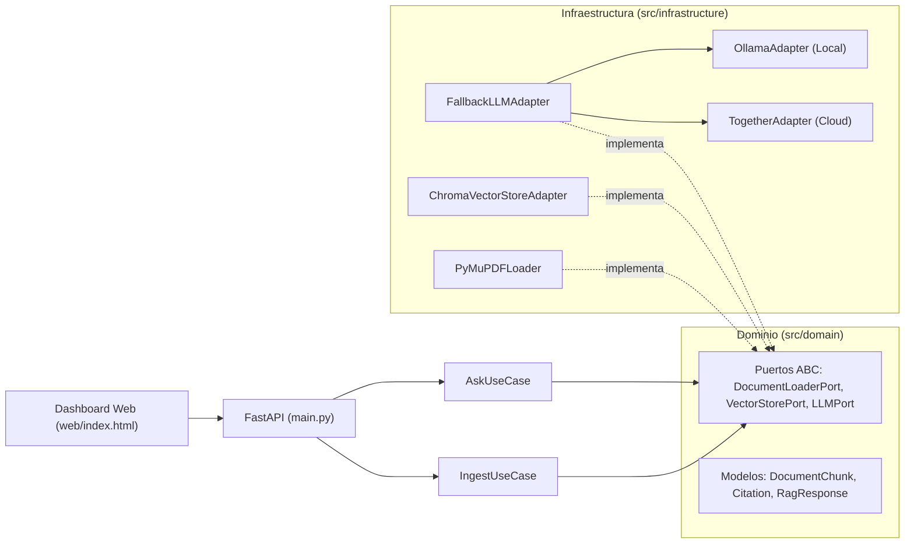
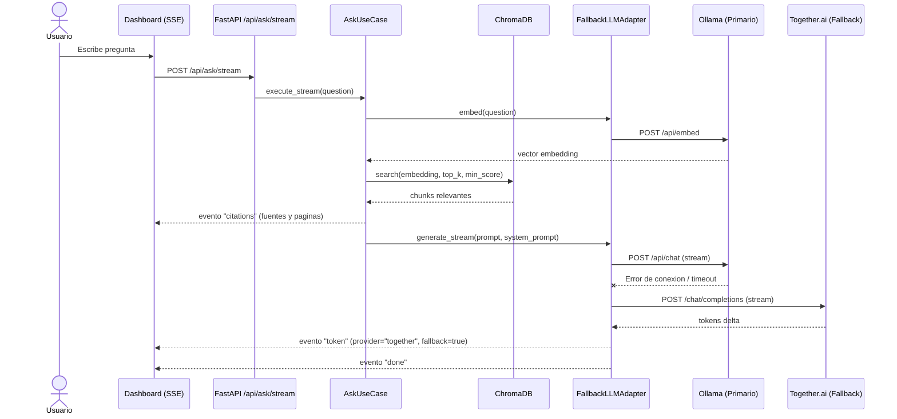

# RAG Conductor

Sistema **RAG (Retrieval-Augmented Generation)** 100% local construido en Python con **Arquitectura Hexagonal estricta**, pensado para consultar manuales y documentos PDF (como el *Libro del Nuevo Conductor*) a través de un dashboard web interactivo con **citas verificables**, **streaming SSE** y **fallback automático entre Ollama y Together.ai**.

---

## Características Principales

* **Arquitectura Hexagonal Estricta:** Separación clara entre `domain` (modelos y puertos), `application` (casos de uso) e `infrastructure` (adaptadores intercambiables).
* **Extracción Inteligente de PDFs:** Lectura página por página con **PyMuPDF (`fitz`)** preservando el número de página real, limpieza de saltos de línea/guiones y chunking con `RecursiveCharacterTextSplitter`.
* **Ingesta Incremental (SHA-256):** Calcula el hash de cada PDF para omitir archivos sin cambios y reemplazar automáticamente los chunks de documentos actualizados.
* **Persistencia Vectorial Local:** **ChromaDB** (`PersistentClient`) configurado con espacio coseno (`hnsw:space=cosine`) y filtrado por umbral mínimo de similitud (`MIN_SIMILARITY_SCORE`) para evitar alucinaciones.
* **Resiliencia con Fallbacks (Ollama ↔ Together.ai):** Orquestador `FallbackLLMAdapter` que conmuta automáticamente al proveedor secundario en generación síncrona y streaming cuando el primario no responde o falla.
* **Dashboard Web Interactivo:** Un único archivo `web/index.html` con **Tailwind CSS**, **Marked.js**, subida de PDFs por *drag & drop*, monitoreo de estado de proveedores y citas desplegables con el fragmento exacto recuperado.

---

## Arquitectura del Sistema

### Arquitectura Hexagonal



### Flujo de Consulta con Streaming SSE y Fallback



---

## Estructura del Proyecto

```text
rag-conductor/
├── documents/                        # Carpeta para colocar los PDFs locales
│   └── .gitkeep
├── chroma_db/                        # Persistencia en disco de ChromaDB
│   └── .gitkeep
├── src/
│   ├── config.py                     # Configuracion tipada con pydantic-settings
│   ├── domain/
│   │   ├── models.py                 # DocumentChunk, Citation, LLMResult, RagResponse, IngestResult
│   │   └── ports.py                  # Interfaces ABC: DocumentLoaderPort, LLMPort, VectorStorePort
│   ├── application/
│   │   ├── ingest_use_case.py        # Ingesta incremental por hash SHA-256 y re-indexacion
│   │   └── ask_use_case.py           # Recuperacion con umbral, prompt estricto y streaming
│   └── infrastructure/
│       ├── loaders/
│       │   └── pymupdf_loader.py     # Extraccion por pagina, limpieza de texto y chunking
│       ├── vectorstores/
│       │   └── chroma_adapter.py     # Persistencia ChromaDB, busqueda coseno y gestion por fuente
│       └── llm/
│           ├── errors.py             # LLMProviderError
│           ├── ollama_adapter.py     # Cliente Ollama (/api/embed, /api/chat, /api/tags)
│           ├── together_adapter.py   # Cliente Together.ai (/embeddings, /chat/completions, /models)
│           └── fallback_llm_adapter.py # Orquestador con fallback automatico
├── web/
│   └── index.html                    # Dashboard UI (Tailwind CSS + Vanilla JS + Marked.js)
├── tests/
│   └── test_use_cases.py             # Pruebas unitarias con mocks
├── main.py                           # Composition root, seguridad y endpoints FastAPI
├── Dockerfile                        # Imagen de produccion con usuario no-root y healthcheck
├── docker-compose.yml                # Despliegue con volumenes persistentes
├── .env.example                      # Plantilla de variables de entorno
├── .gitignore
└── requirements.txt
```

---

## Requisitos Previos e Instalación

1. **Python 3.11 o superior** instalado.
2. **Ollama** instalado localmente ([ollama.com](https://ollama.com)) si usarás modelos locales.
3. *(Opcional)* Una API Key de **Together.ai** para habilitar el fallback en la nube (o usarlo como proveedor primario).

### 1. Clonar e instalar dependencias

**Windows (PowerShell):**

```powershell
python -m venv .venv
.venv\Scripts\Activate.ps1
pip install -r requirements.txt
```

**Linux / macOS:**

```bash
python3 -m venv .venv
source .venv/bin/activate
pip install -r requirements.txt
```

### 2. Descargar modelos en Ollama

```bash
ollama pull nomic-embed-text
ollama pull llama3.1:8b
```

### 3. Configurar variables de entorno

Copia `.env.example` a `.env` y ajusta los valores según tu entorno:

**Windows (PowerShell):**
```powershell
copy .env.example .env
```

**Linux / macOS:**
```bash
cp .env.example .env
```

#### Variables principales en `.env`

| Variable | Valor por defecto | Descripción |
| :--- | :--- | :--- |
| `LLM_PRIMARY` | `ollama` | Proveedor principal (`ollama` o `together`). |
| `LLM_FALLBACK_ENABLED` | `true` | Si `true`, cambia automáticamente al proveedor secundario ante fallos. |
| `EMBEDDING_FALLBACK_ENABLED` | `false` | Se recomienda `false` para evitar inconsistencias de dimensiones en ChromaDB entre modelos distintos. |
| `OLLAMA_HOST` | `http://localhost:11434` | URL del servidor Ollama local. |
| `EMBEDDING_MODEL` | `nomic-embed-text` | Modelo de embeddings en Ollama. |
| `CHAT_MODEL` | `llama3.1:8b` | Modelo de chat en Ollama. |
| `TOGETHER_API_KEY` | *(vacío)* | API Key de Together.ai para chat/fallback. |
| `TOGETHER_CHAT_MODEL` | `meta-llama/Meta-Llama-3.1-8B-Instruct-Turbo` | Modelo de chat en Together.ai. |
| `CHUNK_SIZE` | `1000` | Tamaño máximo de cada fragmento en caracteres. |
| `CHUNK_OVERLAP` | `200` | Solapamiento entre fragmentos consecutivos. |
| `TOP_K` | `5` | Cantidad máxima de fragmentos recuperados por consulta. |
| `MIN_SIMILARITY_SCORE` | `0.30` | Similitud mínima (`0.0` a `1.0`) para aceptar un fragmento como relevante. |
| `MAX_UPLOAD_MB` | `50` | Tamaño máximo permitido por archivo PDF subido. |
| `CORS_ORIGINS` | `*` | Orígenes CORS permitidos separados por coma. |
| `LLM_MAX_RETRIES` | `2` | Reintentos con backoff exponencial ante errores transitorios (`429`/`5xx`/timeout) antes del fallback. |

---

## Cómo Utilizarlo

### 1. Iniciar el servidor

```bash
uvicorn main:app --reload
```

O ejecutando directamente:

```bash
python main.py
```

O con **Docker Compose** (producción):

```bash
docker compose up -d --build
```

Abre el navegador en **`http://localhost:8000`**.

### 2. Uso desde el Dashboard Web

1. **Verifica el estado:** En la barra superior verás si **Ollama** y **Together.ai** están disponibles y cuántos chunks hay indexados.
2. **Sube o agrega PDFs:** Arrastra tu PDF (ej. *Libro del Nuevo Conductor*) a la zona de carga o colócalo manualmente en la carpeta `documents/`.
3. **Indexa los documentos:** Haz clic en **Ingerir nuevos** (solo procesa PDFs nuevos o modificados) o en **Re-indexar** (limpia ChromaDB y vuelve a indexar todo).
4. **Consulta:** Escribe tu pregunta. La respuesta aparecerá en tiempo real (*streaming*), indicando qué proveedor respondió (`ollama` o `together (fallback)`) y mostrando las **fuentes citadas** desplegables con su página y porcentaje de similitud.

### 3. Uso mediante API REST (`curl`)

Documentación interactiva automática de FastAPI disponible en **`http://localhost:8000/docs`**.

* **Verificar salud de proveedores:**
  ```bash
  curl http://localhost:8000/api/health
  ```
* **Subir un PDF:**
  ```bash
  curl -X POST -F "file=@./libro_conductor.pdf" http://localhost:8000/api/documents/upload
  ```
* **Ejecutar ingesta:**
  ```bash
  curl -X POST http://localhost:8000/api/ingest \
    -H "Content-Type: application/json" \
    -d '{"reindex": false}'
  ```
* **Realizar una consulta (respuesta JSON completa):**
  ```bash
  curl -X POST http://localhost:8000/api/ask \
    -H "Content-Type: application/json" \
    -d '{"question": "¿Cual es el limite de velocidad en zona urbana?"}'
  ```
* **Realizar una consulta en streaming (SSE):**
  ```bash
  curl -N -X POST http://localhost:8000/api/ask/stream \
    -H "Content-Type: application/json" \
    -d '{"question": "¿Cual es el limite de velocidad en zona urbana?"}'
  ```

---

## Pruebas Unitarias

Las pruebas verifican la lógica de los casos de uso (`IngestUseCase`, `AskUseCase`) y el orquestador de fallbacks (`FallbackLLMAdapter`) usando mocks, sin necesidad de tener Ollama o Together.ai encendidos:

```bash
python -m pytest -v
```
